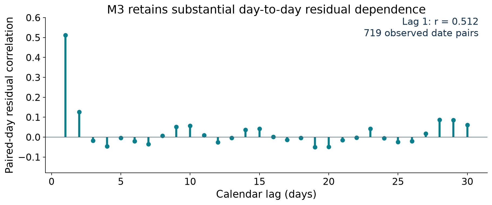

# Beyond R²: Beijing PM2.5 Regression

*Seasonal Effects, Residual Dependence, and Model Adequacy*

How much can weather and season explain daily air pollution, and what remains in the errors? This project examines PM2.5 at Beijing's Wanliu monitoring station using multiple regression, nested-model ANOVA and residual diagnostics. The UCI dataset covers 12 stations from March 2013 to February 2017; Wanliu was selected by training-period completeness. The investigation treats explanatory fit, hypothesis testing and held-out estimation as distinct questions. Its central result is that a modest improvement in average error can coexist with substantial residual dependence and poor estimates during severe pollution episodes.

## Research question

After adjustment for temperature, wind speed, rainfall and pressure, do seasonal offsets and season-specific wind associations improve the description of daily PM2.5? Do the residuals support the assumptions behind conventional regression inference?

Stage 2 is the original confirmatory investigation, with a protocol recorded before fitting. Stage 3 provides exploratory supporting analyses developed after the original test year had been inspected.

## Three principal findings

1. **Joint seasonal evidence depends on the inferential method.** Adding seasonal indicators reduces training SSE, and the classical ANOVA p-value is 0.0033. With calendar-aware HAC covariance and the planned two-test Holm correction, neither primary joint hypothesis rejects at 5%; both adjusted p-values are 0.0618. This does not establish an absence of seasonal structure.
2. **R² conceals remaining temporal dependence.** The selected M3 model has training R² = 0.221, while its lag-one residual correlation is 0.512. Residual spread and upper-tail departures also challenge the adequacy of a simple weather-and-season regression.
3. **Lower average error does not ensure reliable high-day estimates.** Frozen test MAE is 46.785 µg/m³, compared with 55.297 for the training-mean baseline. On 17 high-pollution days, mean estimate minus observation is −160.945 µg/m³. Three negative test estimates remain in the scores.

## Methodology

Hourly observations are aggregated to daily values with explicit completeness rules: at least 18 valid hours for means, all 24 hours for rainfall totals, and 18 jointly observed core hours. Missing dates remain on the calendar; outcomes are not imputed and high concentrations are not trimmed.

Chronological training, validation and test intervals retain 725, 359 and 357 Wanliu days. Training-only centering and a fixed validation-MAE rule compare weather-only M1, seasonal M2 and wind-interaction M3. Classical partial F-tests are interpreted alongside HAC joint tests, residual plots and influence checks.

Exploratory log-response, lagged-PM2.5 and additional-weather models use a separate common sample. Cross-station comparisons, classification and clustering provide context. Their reused test year supplies no new confirmation. All models use observed same-day weather: this is contemporaneous estimation, not advance forecasting. The data are observational, missingness may be informative, and stations share an airshed; neither causality nor independent replication is established.

## Selected visualization



The strong first-lag correlation persists after adjustment for weather and season. Correlations use actual calendar-day pairs, preserving gaps. The figure illustrates why explained variance alone is an incomplete assessment of regression adequacy.

## Report and supporting documentation

- [Academic report](submission/report.pdf) · [readable source](submission/report.md)
- [Presentation PDF](submission/slides.pdf) · [PowerPoint](submission/slides.pptx) · [speaker notes](submission/speaker_notes.md)
- [Data audit](reports/stage1_summary.md), [regression analysis](reports/stage2_analysis.md) and [prefit protocol](reports/stage2_protocol.md)
- [Exploratory analyses](reports/stage3_extensions.md) and [statistical verification](reports/stage4/statistical_audit.md)
- [Reproduction details](reports/reproducibility.md) and [current editorial validation](reports/stage5_refinement.md)

## Reproduction

From a checkout of this revision, use Python 3.13.16, the interpreter used for verification:

```bash
python3 -m venv .venv
.venv/bin/python -m pip install -r requirements.lock
.venv/bin/python -m pip install --no-deps -e .
.venv/bin/python scripts/reproduce.py
```

The runner obtains the original UCI archive, checks its committed checksum, regenerates the analysis and runs the verification steps. Installation and initial acquisition need network access. To rebuild the documents too:

```bash
.venv/bin/python -m pip install -r requirements-submission.lock
.venv/bin/python scripts/reproduce.py --with-submission
```

## References and attribution

Data: Chen, S. (2017), [Beijing Multi-Site Air Quality](https://doi.org/10.24432/C5RK5G), UCI Machine Learning Repository, CC BY 4.0. The report cites Duan's [smearing retransformation method](https://doi.org/10.1080/01621459.1983.10478017) and official statistical-method documentation.

AI assistance: OpenAI Codex and Anthropic Claude assisted code and drafting; Codex assisted verification and editorial refinement. The submitter remains responsible for interpretation and course-policy compliance.
