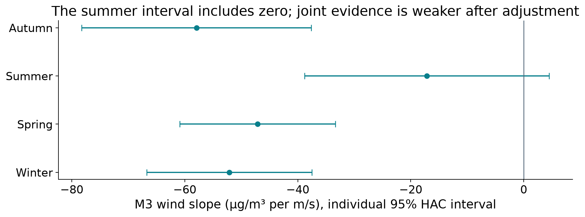
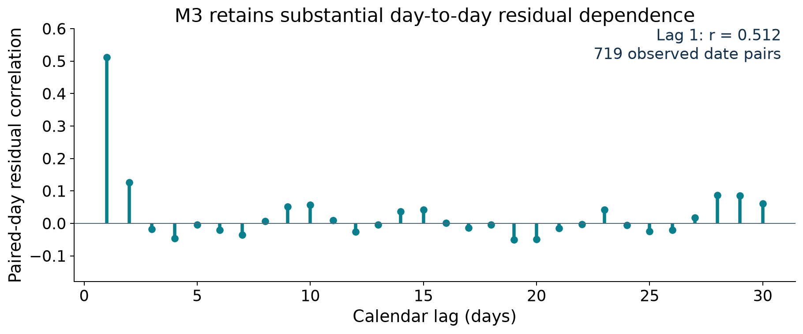
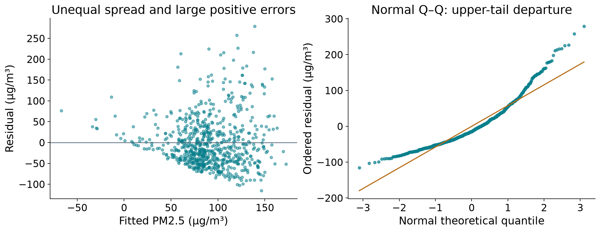
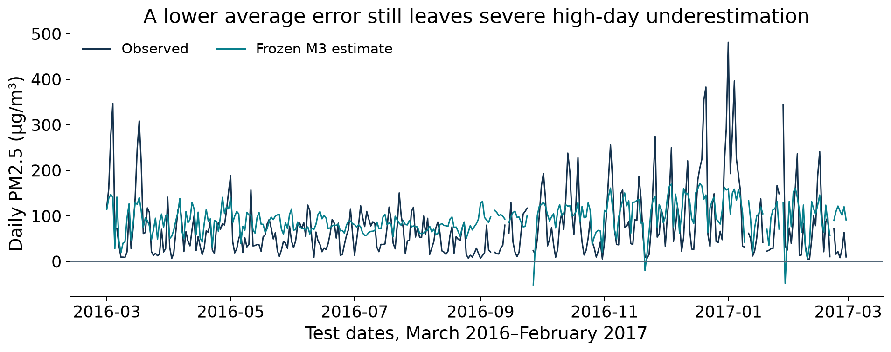
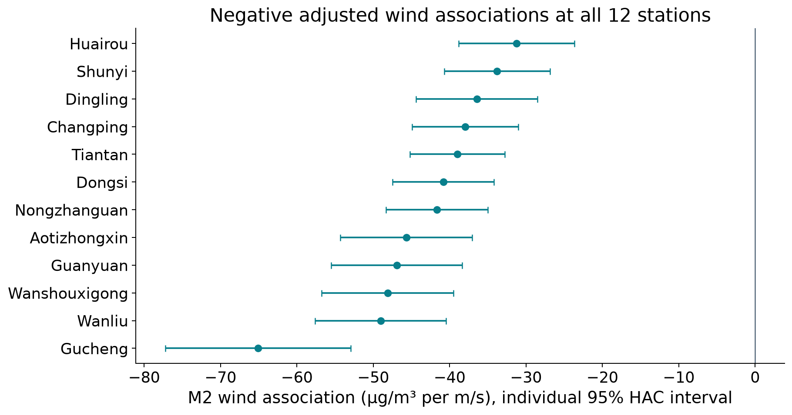
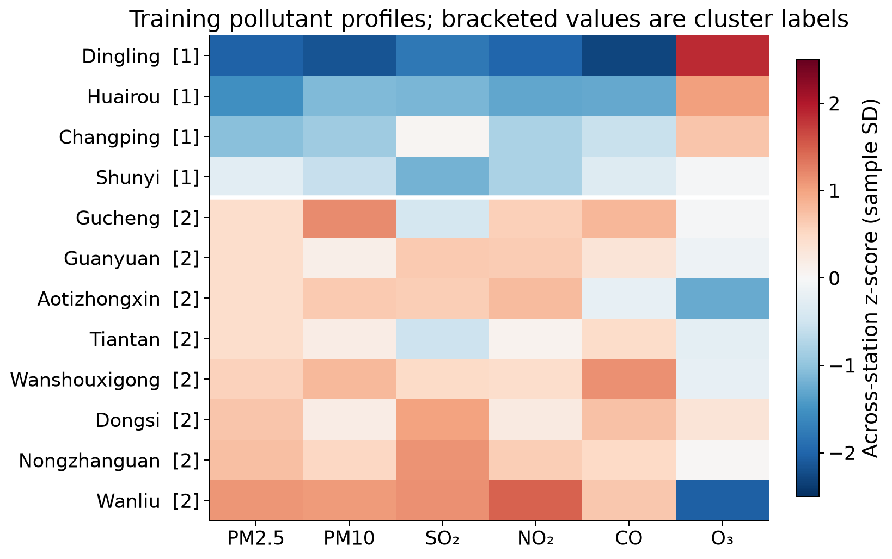

# Beyond R²: Seasonal Effects, Residual Dependence, and Model Adequacy in Beijing PM2.5 Regression

## Abstract

This study asks whether weather and season adequately describe daily PM2.5 at Beijing's Wanliu station. Three nested multiple regressions are compared using ANOVA, calendar-aware HAC joint tests and residual diagnostics. The original confirmatory analysis uses 725 training, 359 validation and 357 test days from the UCI Beijing Multi-Site Air Quality dataset.

The fixed validation rule selects the wind-interaction model M3. Its test MAE is 46.785 µg/m³, compared with 55.297 for the training-mean baseline. Yet its training R² of 0.221 coexists with residual lag-one correlation 0.512, high-day underestimation and negative estimates. Both planned joint hypotheses have Holm-adjusted p = 0.0618; neither rejects at 5%.

These results separate improved fit from adequate errors and stable inference. Later log-response, lag and weather extensions provide exploratory comparisons on a different common sample. All models use observed same-day weather, so their errors describe contemporaneous estimation rather than advance forecasting.

### Research question

After adjustment for temperature, wind speed, rainfall and pressure, do seasonal offsets and season-specific wind associations add information about daily PM2.5? What do the residuals reveal about the adequacy of that regression description?

Stage 2 supplies the original confirmatory investigation, with its protocol fixed before fitting. Stage 3 was developed after the original test year had been inspected. Its findings, including cross-station and classification analyses, therefore support interpretation without providing new confirmation.

Keywords: multiple regression; nested-model ANOVA; HAC covariance; residual dependence; PM2.5.

## 1. Data and study design

The UCI dataset contains 420,768 hourly records at 12 Beijing stations, March 2013–February 2017. Meteorology is matched from nearby weather stations [1,4]. Wanliu is selected by eligible training-day count, then valid training PM2.5 hours and alphabetical name. Future coverage and concentration levels do not enter selection.

A complete 1,461-day calendar preserves unavailable dates. Daily means require 18 valid hours for PM2.5, temperature, pressure and wind speed. Rain totals require all 24 hourly amounts; an analysis day also needs 18 hours with all five fields jointly observed. Means can use different valid-hour subsets. Missing outcomes are not imputed; valid zeros, negative temperatures and high positive concentrations are retained.

Table 1 summarizes the chronological partitions. Their 1,441 eligible days exclude 20 dates; keeping the complete calendar prevents lag calculations from joining observations across those gaps.

| Partition | Dates (end exclusive) | Eligible / calendar days |
| --- | --- | --- |
| Training | 2013-03-01 to 2015-03-01 | 725 / 730 |
| Validation | 2015-03-01 to 2016-03-01 | 359 / 366 |
| Test | 2016-03-01 to 2017-03-01 | 357 / 365 |

Weather and PM2.5 are aggregated on the same local civil dates, assumed Asia/Shanghai because the source gives no explicit timezone. Rain values are interpreted as hourly interval amounts. Completeness filtering and these measurement assumptions limit the interpretation of the retained sample.

Centering constants, the mean baseline and the high-day threshold are estimated from training data only. Validation MAE selects a specification before frozen test scoring. The eligible training daily 95th percentile is 234.655 µg/m³; days at or above it are classified as high. This is a study quantile, not a regulatory or health category.

## 2. Multiple regression and joint inference

Let Y be daily PM2.5 (µg/m³). T, W, R and P denote training-mean-centered temperature (°C), wind speed (m/s), rainfall (mm/day) and pressure (hPa). Winter is the reference season; Ss denotes the spring, summer or autumn indicator. The nested specifications are:

M1: E(Y | X) = β₀ + βT T + βW W + βR R + βP P.
M2 adds Σ γs Ss; M3 adds Σ δs (W × Ss).

Table 2 shows the common-sample training fits. Every design has full rank. Centering preserves fitted values while making seasonal offsets refer to the training mean wind speed; numerical conditioning is assessed separately from coefficient uncertainty.

| Model | Parameters | R² | Adjusted R² | SSE |
| --- | --- | --- | --- | --- |
| M1 | 5 | 0.198 | 0.194 | 2731346.5 |
| M2 | 8 | 0.213 | 0.206 | 2679559.7 |
| M3 | 11 | 0.221 | 0.211 | 2652408.5 |

H1 tests the three seasonal terms jointly in M2 (M1 versus M2). H2 tests the three wind interactions jointly in M3 (M2 versus M3). With q = 3 added parameters, nested-model ANOVA uses F = [(SSErestricted − SSEfull) / q] / [SSEfull / (n − pfull)]. Its exact reference assumes an appropriate linear mean and independent, homoscedastic Gaussian errors [3].

Table 3 contrasts the ordinary F results with primary robust inference. Calendar HAC uses Bartlett-weight score products at actual date separations, zero scores at omitted positions and the n/(n−p) correction. The primary bandwidth is seven days; 14/30-day sensitivities are documented separately. Joint Wald tests use an asymptotic χ²(3) reference; Holm adjustment covers the two primary hypotheses.

| Question | F | Classical p | 7-day HAC p | Holm p |
| --- | --- | --- | --- | --- |
| H1: add season | 4.619 | 0.0033 | 0.0359 | 0.0618 |
| H2: wind × season | 2.436 | 0.0636 | 0.0309 | 0.0618 |

Seasonal indicators reduce SSE and give a small classical H1 p-value, but neither primary joint test rejects after Holm adjustment. This is insufficient evidence against those joint nulls at 5%, not proof that seasonal structure is absent. The distinction matters because the residuals challenge the iid assumptions underlying conventional ANOVA calibration.

## 3. Interpreting the weather associations

Table 4 gives M2's weather coefficients and individual 95% HAC intervals. Each coefficient is a fitted concentration difference per unit higher predictor, conditional on the other listed weather variables and season.

| M2 predictor (one unit) | Difference (µg/m³) | Individual 95% HAC interval |
| --- | --- | --- |
| Temperature (°C) | -2.483 | [-3.985, -0.982] |
| Wind (m/s) | -49.030 | [-57.608, -40.453] |
| Rain (mm/day) | -0.203 | [-1.043, 0.637] |
| Pressure (hPa) | -2.246 | [-3.467, -1.026] |

For wind, the estimated association is -49.030 µg/m³ per m/s, with interval [-57.608, -40.453]. The adjustment is descriptive: it does not identify the effect of an intervention on wind. Conditional temperature or pressure coefficients likewise should not be equated with marginal correlations.

Figure 1 shows M3's seasonal wind slopes. Winter uses the base wind coefficient; the other slopes add the relevant interaction. Their intervals use the full linear-contrast covariance. Summer's interval includes zero, despite a negative point estimate.

These individual intervals are not simultaneous statements about all seasons. Interpretation of the planned seasonal blocks remains tied to the joint tests in Table 3.

## 4. Residual adequacy beyond R²

R² rises from 0.198 in M1 to 0.221 in M3, but Figure 2 shows substantial remaining serial structure. M3's lag-one residual correlation is 0.512, based on 719 adjacent-calendar-day pairs. Daily aggregation has not produced independent errors.

Figure 3 adds two different checks. The residual-versus-fitted plot shows changing spread and large positive errors; the normal Q–Q plot shows an upper-tail departure. A Q–Q plot assesses distributional shape, not temporal independence.

Serial auxiliary, Koenker/Breusch–Pagan and Jarque–Bera diagnostics support this assessment, with reference-distribution assumptions that remain vulnerable to dependence and missingness. The serial regression uses seven calendar-day lags and complete auxiliary rows. Forty observations exceed Cook's-distance screening value 4/n; flags prompt inspection, not deletion.

## 5. Validation selection and frozen test estimates

The fixed rule minimizes validation MAE, preferring fewer parameters among candidates within 1% of the minimum. Table 5 selects M3; M2 is only 1.11% above the minimum, just outside the tolerance. The narrow margin should temper claims of model superiority.

| Candidate | Validation MAE | Validation RMSE |
| --- | --- | --- |
| M1 | 52.025 | 65.519 |
| M2 | 50.660 | 64.579 |
| M3 | 50.104 | 64.171 |

Table 6 reports the original frozen test evaluation in µg/m³. Coefficients, training centers, the baseline and the high-day cutoff are persisted before scoring. There is no validation/test refit or negative-estimate clipping.

| Test evaluation | MAE | RMSE | Mean estimate − observation |
| --- | --- | --- | --- |
| M3 | 46.785 | 60.935 | 15.283 |
| Training mean | 55.297 | 73.006 | 12.897 |
| M3: high days only | 160.945 | 173.583 | -160.945 |

M3 improves average error across 357 dates, yet overall bias is positive while high-day bias is negative. The high-day row contains only 17 observations. Figure 4 shows missed concentration peaks; 3 negative test estimates also expose a physical limitation of unrestricted linear regression.

Dependence prevents a naive independent-day confidence interval for the error difference; none is asserted. The frozen evaluation is reproduced without retuning it or restoring the test year's unseen status.

## 6. Exploratory temporal and weather extensions

Stage 3 explores log1p responses, previous-day PM2.5, dew point and wind vectors. Table 7 compares five candidates on 721 training, 354 validation and 355 test dates. Its common-sample M3 refit and training quantile do not replace the frozen evaluation.

| Common-sample model | Validation MAE | Test MAE* | Test RMSE* |
| --- | --- | --- | --- |
| M3 refit | 50.4 | 46.7 | 60.9 |
| Log M3 | 50.0 | 45.1 | 58.3 |
| M3 + prior PM2.5 | 37.7 | 35.5 | 47.8 |
| M3 + extra weather | 46.9 | 40.7 | 55.4 |
| Log + lag + weather | 32.7 | 29.0 | 40.8 |

*The original test year had already been inspected. The combined model is selected by validation MAE within this exploratory set; lower errors on these dates are not independent confirmation. Errors are compared in original units, while R² values on original and log responses are not directly comparable.

For a log fit, s = mean(exp(training residual)) and the original-unit estimate is exp(linear predictor) × s − 1 [2]. The factors are 1.239 and 1.117. A common factor can misestimate conditional means when residual distributions vary. The formula bounds estimates above −1, not zero; nonnegative estimates are an empirical result here.

Lags are constructed before filtering on the complete calendar. An unavailable prior PM2.5 day makes its lag missing. Actual earlier validation/test outcomes become available to later same-day estimates, so this is a rolling estimation task rather than an open-loop forecast.

### AR(1) calendar-gap sensitivity

Original GLSAR compresses retained rows, treating five two-day gaps as one step. Table 8 holds conditional-likelihood estimation and first-observation treatment fixed while comparing row versus actual-calendar transitions ρᵈ with gap-adjusted innovation variance.

| Method | M2 ρ | H1 nominal p | H2 nominal p |
| --- | --- | --- | --- |
| Original GLSAR rows | 0.572 | 0.0033 | 0.4616 |
| Likelihood rows | 0.571 | 0.0033 | 0.4610 |
| Likelihood calendar | 0.583 | 0.0026 | 0.4475 |

Nominal decisions, including within-method Holm, are unchanged. The plug-in F reference omits uncertainty in fitted ρ. Stationary Gaussian AR(1) is a working assumption; these exploratory results do not override primary HAC/Holm inference.

## 7. Cross-station consistency and classification

Figure 5 compares M2 wind associations at all 12 stations, each using its own eligible dates, training centers and cutoff. All individual intervals lie below zero. H1/H2 pass within-station Holm adjustment at 6/2 sites; this does not correct the full family of 24 tests. Stations share pollution and weather, so their agreement is not independent replication.

M3 improves test MAE over its station training-mean baseline at 11/12 sites; Gucheng is the exception. The cross-station patterns are exploratory descriptions of this historical network.

### High-day classification

An M2 logistic model uses the training daily 95th percentile (234.655 µg/m³) to define its outcome. Validation F1 selects probability cutoff 0.1323, with higher-cutoff tie breaking. On 357 test days, including 17 high days, TP/FP/FN/TN are 15/44/2/296.

AUC is 0.927, recall 0.882 and precision 0.254; a 0.5 cutoff detects no high days. Good ranking therefore coexists with many false alarms. Rare events and serial dependence limit precision, and nominal odds-ratio intervals assume independence. The class is a statistical quantile, not a health standard.

## 8. Clustering, limitations and conclusions

Figure 6 summarizes six pollutant-specific training means, standardized across stations with sample SD. The largest Ward merge-height gap for k=2…5 selects two groups. The lower mean-PM2.5 group contains Changping, Dingling, Huairou, Shunyi; the remaining eight stations form the other group. Pollutants can use different qualified dates; geographic meaning and new-period cluster stability have not been established.

### Limits of the evidence

The study is observational and limited to four historical years in one city. Omitted emissions, transport and boundary-layer information, nearest-station weather, selective completeness and temporal shifts can affect the associations. HAC cannot repair an inadequate conditional mean. Individual intervals and station-wise tests do not supply simultaneous protection across the exploratory analyses.

### Conclusion

Seasonal terms reduce SSE, but adjusted joint evidence and residual diagnostics give a more cautious assessment than training fit alone. M3 lowers average same-day test error while missing severe episodes and permitting negative estimates. Exploratory temporal/weather features improve errors on these dates. A defensible next step is an unseen period, prespecified rules and an explicit account of covariates available when an estimate is issued.

## 9. Reproducibility and references

The original UCI archive, chronological configurations, fixed environment and prefit protocol identify the investigation. Training parameters, dated predictions and per-run hashes are retained. Numerical claims in this report are read from generated artifacts and linked to their source rows in submission/build_manifest.json.

The repository's reproduction runner regenerates the analysis and documents. Independent aggregation, QR/HAC, logistic and direct Ward implementations check the calculations; a dense conditional covariance checks AR(1) sensitivity. Agreement is computational verification, not independent scientific replication. Detailed commands and evidence are in reports/reproducibility.md and reports/stage5_refinement.md.

### References

[1] Chen, S. (2017). Beijing Multi-Site Air Quality [Dataset]. UCI Machine Learning Repository. CC BY 4.0. [DOI: 10.24432/C5RK5G](https://doi.org/10.24432/C5RK5G)

[2] Duan, N. (1983). Smearing Estimate: A Nonparametric Retransformation Method. Journal of the American Statistical Association, 78(383), 605–610. [DOI: 10.1080/01621459.1983.10478017](https://doi.org/10.1080/01621459.1983.10478017)

[3] Statsmodels. Regression F-test documentation. [Official method documentation](https://www.statsmodels.org/stable/generated/statsmodels.regression.linear_model.RegressionResults.compare_f_test.html)

[4] UCI. Beijing Multi-Site Air Quality: dataset documentation. [Dataset documentation](https://archive.ics.uci.edu/dataset/501/beijing+multi+site+air+quality+data)

Further method documentation: [Bartlett HAC covariance](https://www.statsmodels.org/stable/generated/statsmodels.stats.sandwich_covariance.cov_hac.html) · [Iterative GLSAR](https://www.statsmodels.org/stable/generated/statsmodels.regression.linear_model.GLSAR.html)

### AI assistance

OpenAI Codex and Anthropic Claude assisted code and drafting. Codex assisted verification and editorial refinement. Numerical claims are tied to generated artifacts. The submitter remains responsible for interpretation and course-policy compliance.
